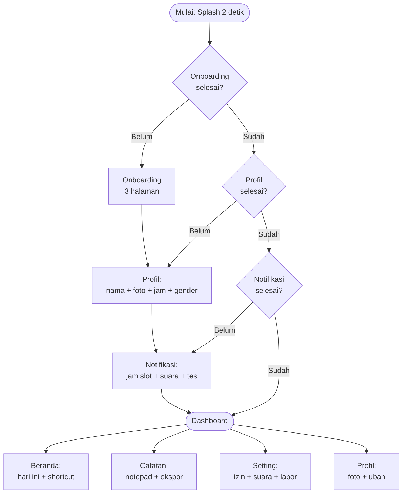
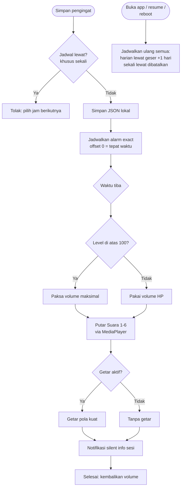
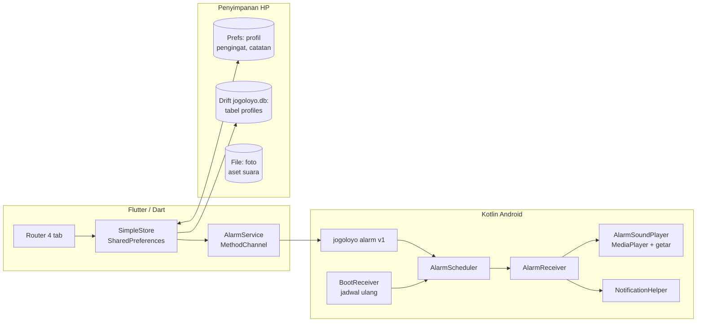
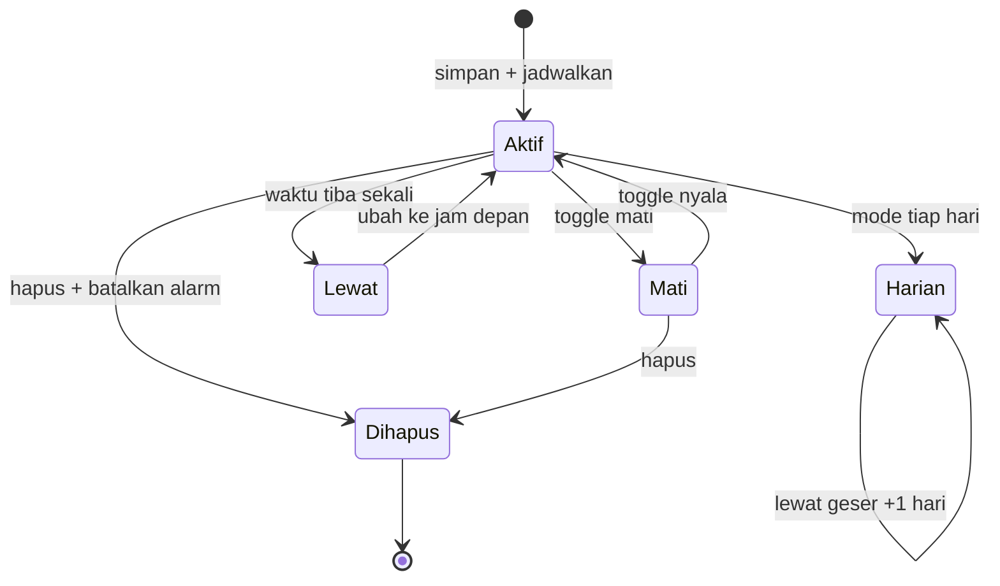
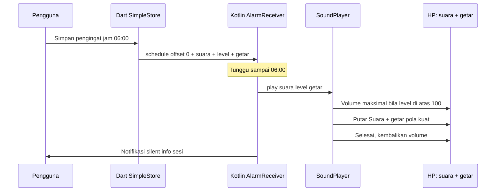
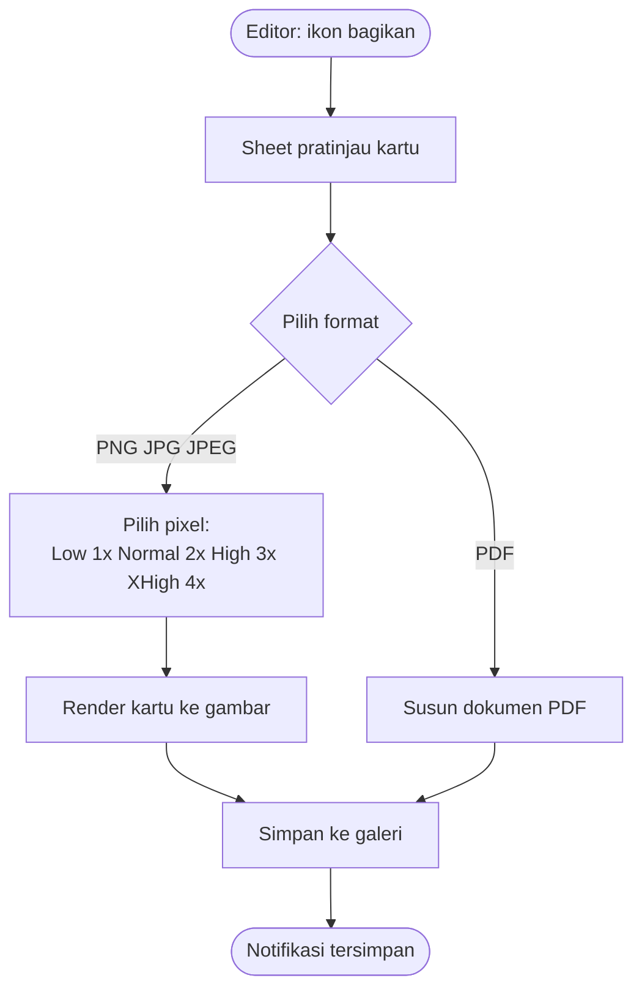

<p align="center">
  
</p>

<h1 align="center">Les Jogoloyo</h1>

<p align="center">
  <b>Aplikasi pengingat berbunyi plus catatan. 100 persen offline.</b>
</p>

<p align="center">
  
  
  
  
</p>

> Semua diagram di bawah bisa diklik untuk tampil penuh (maximize) di GitHub.

---

## Daftar Isi

1. [Ringkasan](#1-ringkasan)
2. [Alur Aplikasi](#2-flowchart-alur-aplikasi)
3. [Alur Pengingat Berbunyi](#3-flowchart-pengingat-berbunyi)
4. [Arsitektur Lokal](#4-flowchart-arsitektur-lokal)
5. [Siklus Hidup Pengingat](#5-diagram-siklus-hidup-pengingat)
6. [Urutan Bunyi Alarm](#6-diagram-urutan-bunyi-alarm)
7. [Peta Penyimpanan Lokal](#7-diagram-peta-penyimpanan-lokal)
8. [Ekspor Catatan](#8-flowchart-ekspor-catatan)
9. [Detail Fitur](#9-detail-fitur)
10. [Copy Notifikasi](#10-copy-notifikasi)
11. [Suara Bawaan](#11-suara-bawaan)
12. [Izin Android](#12-izin-android)
13. [Kontrak Channel Native](#13-kontrak-channel-native)
14. [Struktur Kode](#14-struktur-kode)
15. [Cara Jalan dan Verifikasi](#15-cara-jalan-dan-verifikasi)
16. [Matriks Uji](#16-matriks-uji)
17. [Masalah Umum](#17-masalah-umum)
18. [Catatan Rilis](#18-catatan-rilis)

---

## 1. Ringkasan

Les Jogoloyo V.02 adalah aplikasi pengingat harian yang beneran berbunyi tepat waktu plus getar, lengkap dengan notepad yang bisa diekspor ke galeri sebagai gambar atau PDF.

Prinsip:

1. Simpel: hanya pengingat plus catatan. Tanpa chat, tanpa AI, tanpa server.
2. Lokal: semua data di HP (SharedPreferences plus file). Internet tidak wajib.
3. Tepat: alarm exact Android, bukan notifikasi biasa yang bisa telat.
4. Keras: level 100% sampai 200% plus getar yang bisa mati hidup.

Fitur inti:

| # | Fitur | Isi singkat |
|---|---|---|
| 1 | Pengingat | Judul, tanggal, jam WIB, slot cepat, harian, Suara 1-6, level 100-200%, getar, tes langsung |
| 2 | Catatan | Cari, tulis, ubah, geser hapus plus urungkan, ekspor gambar dan PDF ke galeri |
| 3 | Profil | Nama, foto kamera autosave, jam utama, gender |
| 4 | Setting | Izin sistem, suara default, play stop, lapor masalah plus log, reset |

Alur pertama kali pakai:

```
Loading (2 detik) > Onboarding (3 halaman) > Profil (nama + foto + jam + gender)
> Notifikasi (jam slot + suara + tes) > Dashboard
```

Navigasi bawah (4 tab): **Beranda, Catatan, Setting, Profil**.
Daftar pengingat dibuka dari shortcut dashboard. PIN dan kunci tidak dipakai di V.02.

---

## 2. Flowchart Alur Aplikasi



## 3. Flowchart Pengingat Berbunyi



## 4. Flowchart Arsitektur Lokal



## 5. Diagram Siklus Hidup Pengingat



## 6. Diagram Urutan Bunyi Alarm



## 7. Diagram Peta Penyimpanan Lokal

```mermaid
flowchart TD
    subgraph PREF[SharedPreferences]
        A[user_name user_photo\nuser_slot user_gender]
        B[onboarding_done\nprofil_done notif_done]
        C[default_sound\ndefault_level default_vibrate]
        D[slot_Pagi Siang Sore Malam\nformat HH:mm]
        E[reminders_v1\nlist JSON pengingat]
        F[notes_v1\nlist JSON catatan]
        G[reports_v1\nlist JSON laporan]
        H[alarm id me\noffset suara level getar]
        I[active_profile_id]
    end
    subgraph SECURE[Secure Storage]
        J[les_key_b64\nkunci HMAC 32 byte]
    end
    subgraph DB[(Drift jogoloyo.db)]
        K[tabel profiles:\nid nama PIN hash\nfoto gender mapel]
    end
    subgraph FILE[File App]
        L[teacher_photos\nfoto jpg kompres]
        M[assets music\nsuara1-6 bawaan APK]
    end
    A --> E
    C --> E
    D --> E
    E --> H
    I --> K
    A -. foto path .-> L
```

## 8. Flowchart Ekspor Catatan



---

## 9. Detail Fitur

### 9.1 Pengingat

| Item | Aturan |
|---|---|
| Judul | Bebas, kosong jadi Pengingat |
| Waktu | Tanggal plus jam WIB, sekali tolak bila lewat |
| Slot cepat | Pagi 06:00, Siang 12:00, Sore 15:30, Malam 19:00, bisa diubah per slot |
| Harian | Jam sama tiap hari, yang lewat otomatis geser +1 hari saat app dibuka |
| Suara | Suara 1 sampai 6 dari assets/music, ketuk langsung dengar |
| Kekerasan | 100% normal pakai volume HP, 125-200% paksa maksimal plus gain |
| Getar | Bisa mati hidup per pengingat dan sebagai default |
| Tes | Play bunyikan sekarang, Stop hentikan seketika |

### 9.2 Catatan

| Item | Aturan |
|---|---|
| Daftar | Kartu strip warna, tanggal WIB, hitung kata, terbaru dulu |
| Cari | Judul dan isi, langsung filter |
| Hapus | Geser kanan, dialog konfirmasi, snackbar Urungkan |
| Editor | Judul besar, isi lega, hitung kata live, bar simpan lengket |
| Ekspor gambar | PNG JPG JPEG, pixel Low 1x Normal 2x High 3x XHigh 4x, anti burik |
| Ekspor PDF | Judul, tanggal, isi rapi, simpan ke galeri |

### 9.3 Profil dan Setting

| Layar | Isi |
|---|---|
| Profil | Foto besar (Ganti Foto autosave), nama, jam, gender, jalan ke ubah profil dan waktu |
| Setting | Status izin notifikasi plus Minta, status exact plus Buka, suara default, level, getar, Play Stop, ubah waktu, lapor masalah, reset |
| Lapor Masalah | Judul plus rincian, simpan lokal, bagikan teks plus file log ke admin |
| Reset | Hapus semua prefs, kembali ke onboarding |

---

## 10. Copy Notifikasi

Teks asli dari `NotificationHelper`. V.02 hanya menjadwalkan offset 0.

| Momen | Teks |
|---|---|
| Berbunyi (offset 0) | Saatnya masuk: judul |
| Tes Keras | 10 menit lagi masuk kelas. Siapkan buku dan alat tulis |
| Tes Info | 30 menit lagi: Tes Alarm. Aktifkan suara HP |
| Sukses simpan | Tersimpan. Akan berbunyi plus getar tepat waktu |

---

## 11. Suara Bawaan

| Nama | File | Ukuran | Isi |
|---|---|---|---|
| Suara 1 | suara1.mp3 | 1,8 MB | Nada alarm Thailand |
| Suara 2 | suara2.mp3 | 0,9 MB | Dreamscape lembut |
| Suara 3 | suara3.mp3 | 2,0 MB | Mellow klasik |
| Suara 4 | suara4.mp3 | 0,9 MB | Oversimplified ceria |
| Suara 5 | suara5.wav | 1,5 MB | Buzzer digital |
| Suara 6 | suara6.wav | 1,6 MB | Morning clock |

Total sekitar 8,7 MB. File asli ada di folder `music`, salinan rapi di `assets/music`.

---

## 12. Izin Android

| Izin | Fungsi | Cara dapat |
|---|---|---|
| POST_NOTIFICATIONS | Banner muncul | Dialog sistem via tombol Minta |
| SCHEDULE_EXACT_ALARM | Bunyi tepat menit | Halaman pengaturan via tombol Buka |
| VIBRATE | Getar | Otomatis |
| MODIFY_AUDIO_SETTINGS | Gain di atas 100% | Otomatis |
| RECEIVE_BOOT_COMPLETED | Jadwal ulang setelah reboot | Otomatis |
| CAMERA | Foto profil | Dialog sistem saat ambil foto |

---

## 13. Kontrak Channel Native

Channel: `jogoloyo/alarm/v1`. Semua waktu ISO UTC.

| Metode | Param | Balikan |
|---|---|---|
| scheduleSessionAlarm | sessionId, startUtcIso, offsetsMinutes, title, room, sound, level, vibrate | true atau error SCHEDULER_BUSY |
| cancelSessionAlarm | sessionId | true |
| cancelAllAlarms | - | true |
| testAlarm | kind info atau urgent, sound, level, vibrate | true |
| stopAlarmSound | - | true |
| requestNotifications | - | true atau error PERMISSION_DENIED |
| arePermissionsGranted | - | map exactAlarm, notifications, fullScreenIntent |
| openExactAlarmSettings | - | true |

Aturan: ID alarm unik dari hash kunci plus offset. Waktu lewat tidak dijadwalkan. Volume yang dipaksa selalu dikembalikan.

---

## 14. Struktur Kode

```
lib/
  app/            tema, router 4 tab
  core/alarm/     AlarmService channel jogoloyo/alarm/v1
  core/log/       log lokal 100 baris plus dump file
  core/security/  hash PIN dan HMAC (cadangan)
  data/local/     app_db Drift profil, les_store, simple_store pengingat catatan
  features/       splash, onboarding, profil setup, notif setup,
                  home, reminder, notes, setting, profile
  shared/widgets/ logo, states, level picker
android/.../alarm/  Scheduler, Receiver, SoundPlayer, NotificationHelper, Store
tools/forbid_scan.dart  linter teks anti karakter U+2014 dan U+2013
assets/           logo.png, music suara1-6, strings
test/             alarm, security, widget 4 tab
```

---

## 15. Cara Jalan dan Verifikasi

```powershell
flutter pub get
dart run build_runner build
flutter run
```

Wajib sebelum commit:

```powershell
flutter analyze
flutter test
dart run tools/forbid_scan.dart
```

Target: analyze bersih, test hijau, lint OK tanpa karakter U+2014 dan U+2013 di `lib`, `android/app/src/main`, `assets/strings`.

Build APK ringan per ABI (hasil jauh di bawah 200 MB):

```powershell
flutter build apk --release --split-per-abi
Get-ChildItem build\app\outputs\flutter-apk | Format-Table Name
```

---

## 16. Matriks Uji

| Area | Cara uji | Lolos bila |
|---|---|---|
| Alarm tepat | Set H-0 dua menit lagi, tutup app | Bunyi plus getar dalam toleransi 1 menit |
| Reboot | Set alarm, reboot, tanpa buka app | Tetap bunyi |
| Suara | Ganti Suara 1-6, Play tiap ganti | Semua terdengar beda |
| Level | Play 100% lalu 200% | 200% jelas lebih keras |
| Getar mati | Getar mati, Play | Hanya suara |
| Stop | Play lalu Stop | Berhenti seketika |
| Harian lewat | Simpan harian jam lewat, buka app | Geser ke besok |
| Izin ditolak | Tolak notifikasi, buka Setting | Label mati plus tombol Minta |
| Ekspor | Ekspor PNG XHigh dan PDF | Ada di galeri dan tajam |
| Urung hapus | Geser hapus catatan, Urungkan | Catatan kembali |

---

## 17. Masalah Umum

| Gejala | Sebab | Atasi |
|---|---|---|
| Tidak bunyi | Izin exact mati atau optimasi baterai | Setting tekan Buka, aktifkan. Xiaomi aktifkan Autostart. Samsung set Unrestricted |
| Banner tidak muncul | Notifikasi mati | Setting tekan Minta |
| Suara kecil | Level 100% | Naikkan ke 175% atau 200% |
| Alarm telat 1 menit | Vendor tunda exact | Aktifkan izin plus matikan optimasi baterai |
| Foto hilang | File dihapus manual | Ambil ulang di Profil, autosave lagi |
| Build gagal Kotlin cache | Drive beda C vs D | `kotlin.incremental=false` sudah diset di gradle.properties |

---

## 18. Catatan Rilis

Lihat `CHANGELOG.md` untuk riwayat versi dan `plan.md` untuk spesifikasi produk awal.
V.02 simpel: hanya pengingat plus catatan. File fitur lama sudah dihapus total dari kode.
Lapor masalah dari aplikasi ikut mengirim file log agar admin cepat paham.
